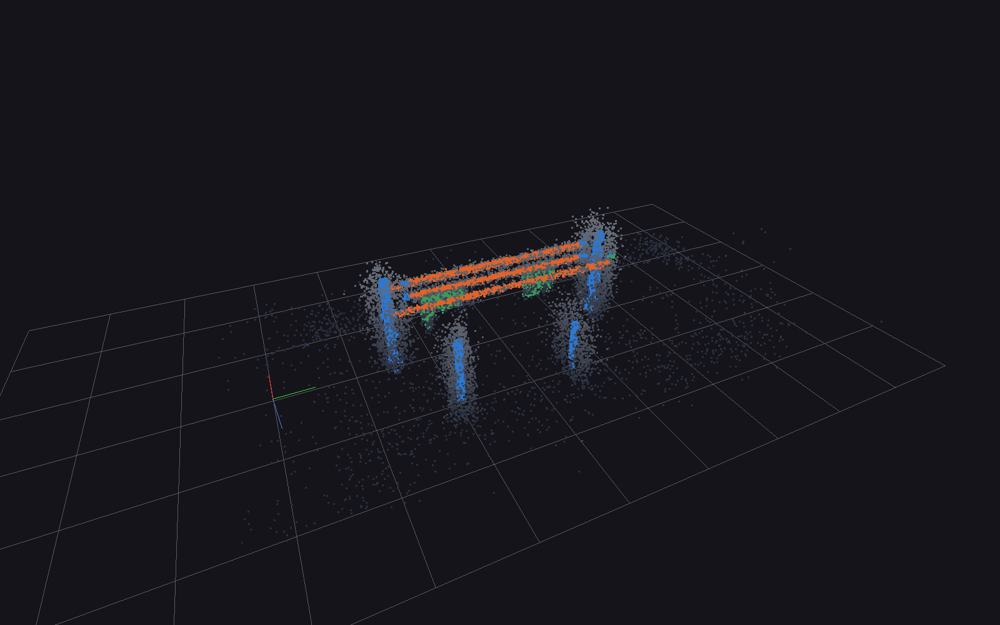
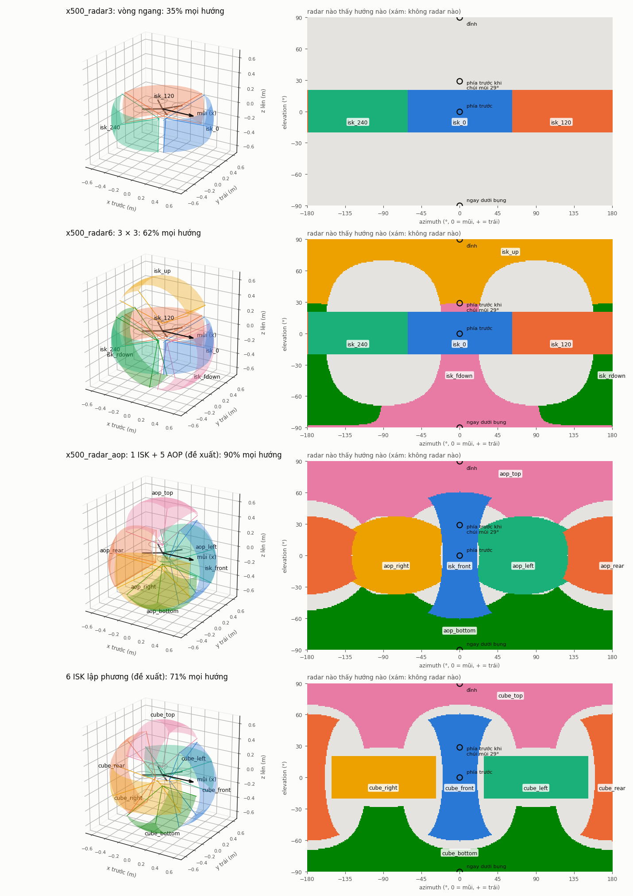
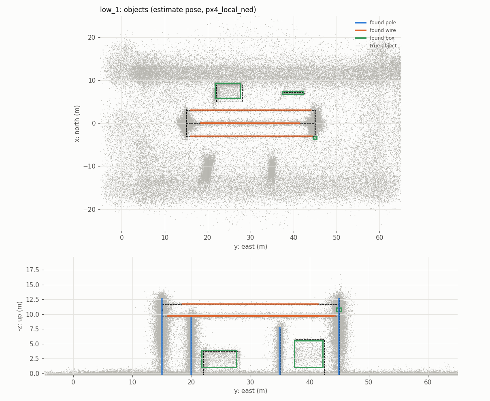

# px4-radar-mapping

Né vật cản và lập map bằng radar mmWave trên PX4 SITL (Gazebo Harmonic, ROS 2 Humble).

- **Né vật cản:** sáu radar TI IWR6843 (1 ISK nhìn trước + 5 AOP) cho một đám điểm 3D quanh drone. Một node Python
  né dây điện, cột, tường bằng cách sửa vận tốc gửi tới PX4 (Offboard), theo bài báo Malle & Ebeid, ICRA 2026 [1].
- **Lập map:** cùng bộ radar, cộng pose RTK của PX4. Mỗi vật (cột, dây, nhà, tường) có vị trí, kích thước và point
  cloud riêng, trong hệ local NED của PX4. Map có thể lập thời gian thực qua đường truyền ≤ 300 kbit/s, hoặc sau
  chuyến bay từ log.

PX4 chạy nguyên bản; mọi thứ của dự án nằm trong thư mục này. Riêng chế độ `GPS=rtk` của bài lập map cần một patch
nhỏ cho `gz_bridge` (xem [Cài đặt](#1-cài-đặt)).



Toàn bộ kết quả là **mô phỏng**: mô hình radar chưa được đối chiếu với radar thật.

## Mục lục

1. [Cài đặt](#1-cài-đặt)
2. [Setup radar hiện tại](#2-setup-radar-hiện-tại)
3. [Né vật cản](#3-né-vật-cản)
4. [Lập map bằng radar + RTK](#4-lập-map-bằng-radar--rtk)
5. [Xem point cloud 3D](#5-xem-point-cloud-3d)
6. [Lưu ý khi chạy](#6-lưu-ý-khi-chạy)
7. [Tài liệu tham khảo](#7-tài-liệu-tham-khảo)

## 1. Cài đặt

**Cần có:**
- Ubuntu 22.04, mã nguồn [PX4-Autopilot](https://github.com/PX4/PX4-Autopilot) build được `make px4_sitl`.
- Gazebo Harmonic, kèm Python binding (`python3-gz-transport13`, `python3-gz-msgs10`).
- ROS 2 Humble (RViz2, `rclpy`).
- Python: `numpy scipy matplotlib pyyaml pytest pymavlink pyulog pybind11 open3d`.

**Clone vào trong cây PX4**, đúng chỗ `examples/px4-mapping` (các script tìm PX4 ở hai cấp thư mục phía trên; đặt
chỗ khác thì đặt biến `PX4_DIR=/đường/dẫn/PX4-Autopilot`):

```bash
cd ~/PX4-Autopilot
git clone git@github.com:do010303/px4-radar-mapping.git examples/px4-mapping
```

**Patch GPS cho bài lập map** (một lần). Patch thêm các tham số `SIM_GZ_GPS_PNOIS`, `SIM_GZ_GPS_EPH`,
`SIM_GZ_GPS_EPV`… cho `gz_bridge`, để mô phỏng được bộ thu RTK (2 cm) hay GPS thường (~1 m). Chỉ bài lập map với
`GPS=rtk` / `GPS=std` cần nó; né vật cản chạy được trên PX4 gốc.

```bash
cd ~/PX4-Autopilot
git apply examples/px4-mapping/patches/gz_bridge_gps_params.patch
```

**Build và sinh model** (một lần; sinh lại model sau mỗi lần sửa `profiles/*.yaml` hay `scripts/radar_layouts.py`):

```bash
cd ~/PX4-Autopilot && make px4_sitl
cd examples/px4-mapping
source env.sh                     # ROS 2 Humble + partition Gazebo riêng của dự án
scripts/make_isk_x3.sh            # model radar và các vehicle nhiều radar
cpp/build.sh                      # lõi C++ của bộ lập map (không có thì chạy bằng Python, chậm ~55 lần)
python3 -m pytest tests -q        # unit test, không cần Gazebo: phải ra "107 passed"
```

Mọi lệnh dưới đây chạy trong `examples/px4-mapping/`. Mỗi terminal mới: `cd` vào đó rồi `source env.sh`.

## 2. Setup radar hiện tại

**Bố trí: 1 ISK + 5 AOP** (`models/x500_radar_aop`, chọn bằng `RADARS=aop`), như trong bài báo [1]:

| Radar | Loại | Vùng nhìn | Thấy dây Ø 20 mm từ | Gắn |
|---|---|---|---|---|
| trước | TI IWR6843**ISK** [9] | 122° × 41°, 10 Hz, 0,2–30 m | ~15 m | quạt 122° dựng đứng: vẫn thấy dây phía trước khi drone chúi mũi tới 60° |
| sau | IWR6843**AOP** [10] | 75° × 104° | ~7–8 m | quạt rộng nằm ngang |
| trái, phải | AOP | 75° × 104° | ~7–8 m | xoay 15° về phía trước |
| trên, dưới | AOP | 75° × 104° | ~7–8 m | nhìn thẳng lên / xuống; ngay dưới bụng nằm đúng trục ngắm |

- Phủ **90,6 %** mọi hướng và 98 % dải ±30° quanh phương ngang (nơi có dây).
- Chỉ phía trước nhìn xa 15 m, nên drone quay mũi theo hướng bay. Tốc độ an toàn v ≤ √(2·a·(tầm − margin)): khoảng
  9 m/s về phía trước, khoảng 6 m/s theo các hướng khác. Bài báo báo cáo mức tương tự: 10 m/s phía trước, 5 m/s các
  hướng khác.
- AOP sau và hai bên gắn thấp hơn thân 15 cm: gắn cao hơn thì chúng thấy cánh quạt của chính drone.



Bố trí khác vẫn chạy được bằng `RADARS=3` (ba ISK vòng ngang, phủ 35 %) và `RADARS=6` (3 × 3 ISK, phủ 62 %).

**Mô hình radar.** Gazebo không có sensor radar, nên radar được mô phỏng ở mức đám điểm đầu ra (như firmware TI xuất):
- Mỗi radar là một `gpu_lidar` cùng vùng nhìn (lưới tia 1° × 1°).
- `scripts/radar_model.py` gom tia vào ô phân giải (khoảng cách 0,12 m × góc 15° với ISK, 8° với AOP), tính SNR theo
  khoảng cách, giữ ô vượt ngưỡng CFAR, rồi thêm nhiễu: khoảng cách σ 2,8 cm, góc σ 3–5°.
- Dây mảnh hơn khoảng cách giữa các tia, nên có mô hình riêng (trụ mảnh, σ = 2π·a·R).
- Lọc Doppler bỏ các điểm bị đặt sai góc.
- Tham số theo cấu hình radar tác giả bay và bài báo; phần còn lại là ước lượng, có ghi chú trong
  `profiles/iwr6843isk.yaml` và `profiles/iwr6843aop.yaml`.

Đọc đám điểm: khoảng cách rất chính xác (±3 cm), hướng kém (±3–5°, tức gần 1 m ở 10 m). Dây hiện thành một hàng
chấm thưa, chỉ ở đoạn gần vuông góc với hướng nhìn; tường lớn chỉ còn vài chục chấm.

## 3. Né vật cản

### Chạy

Hai terminal. Terminal 1 mở sim, Gazebo và RViz; terminal 2 bay.

```bash
# terminal 1: 1 ISK + 5 AOP, world chuỗi vật cản
source env.sh
RADARS=aop PX4_GZ_WORLD=power_line_course ./run_sitl.sh

# terminal 2: chờ terminal 1 hiện "PX4 SITL ready" rồi thêm ~15 s
source env.sh
scripts/avoid_node.py --world power_line_course --speed 5 --timeout 150 \
    --waypoints 20,0,10 39,0,10 50,0,10 60,0,10 71,0,10 82,0,10 98,0,10

# sau chuyến bay: khoảng cách tới từng vật cản, độ cao lúc qua, thời gian phanh
python3 scripts/course_report.py out/avoid.csv --world power_line_course
```

World `power_line_course`, theo thứ tự trên đường bay:
- đường dây ba pha (ba dây 20 mm ở 10 m, dây đất ở 12 m, thân cây lệch 2,5 m);
- tường thấp (đỉnh 9 m);
- ống ngang trên cao (11,5 m);
- cổng hai cột, lệch 2,2 m mỗi bên;
- khối hộp bên phải;
- một dây thấp (8,8 m).

Kỳ vọng: chui dưới dây điện và ống ngang, vượt trên tường và dây thấp, bay giữa cổng, vòng trái khối hộp, cách mọi
vật khoảng 2 m. Cuối chuyến node in `result: PASS` (bay hết mission, không lúc nào cách vật dưới 1 m) hoặc `FAIL`,
ghi `out/avoid.csv`, rồi hạ cánh. Bay lại: `scripts/stop_sim.sh` rồi chạy lại cả hai terminal.

**Các bài khác** (terminal 1: `RADARS=aop ./run_sitl.sh`, world mặc định `power_line`):

| Bài | Terminal 2 |
|---|---|
| Dây điện, bay thẳng 5 m/s | `scripts/avoid_node.py --goal 45 0 10 --speed 5` |
| Tốc độ cao | `scripts/avoid_node.py --goal 45 0 10 --speed 10` |
| Close proximity (đích nằm trên dây) | `scripts/avoid_node.py --goal 27 0 10 --speed 1.5 --timeout 40 --proximity-test` |
| Chui dưới dây (mission ở 8 m) | `scripts/avoid_node.py --waypoints 10,0,8 45,0,8 45,10,8` |
| Dây thép 1,2 mm | terminal 1 thêm `PX4_GZ_WORLD=power_line_thin`; `scripts/avoid_node.py --world power_line_thin --goal 45 0 10 --speed 2` |

Tuỳ chọn hay dùng của `avoid_node.py`:
- `--way-round shortest` (mặc định) hoặc `paper`: cách né, xem bên dưới.
- `--mode brake`: chỉ phanh và giữ.
- `--clearance 2`: biên mong muốn khi né (m).
- `--demo`: bay tới hết `--timeout`, không hạ cánh.
- `--help`: toàn bộ tuỳ chọn.

**Xem trên RViz** (lớp "Avoidance logic", `/avoid/markers`):

| Hình | Ý nghĩa |
|---|---|
| cầu xanh dương | hình cầu tránh r_a 8 m; điểm phía trước nằm trong nó (tím) quyết định cách né |
| cầu đỏ | hình cầu an toàn r_s 1,5 m; điểm trong nó (đỏ, to) đẩy drone ra xa |
| hình nón | vùng phanh khẩn cấp dọc hướng bay, dài v²/2a + margin; đỏ khi đang phanh |
| mũi tên | xanh lá: vận tốc mong muốn; trắng: vận tốc thật; vàng: lệnh gửi PX4; tím: thành phần né; đỏ: đẩy ra |
| chữ trên drone | luật đang áp dụng (`free flight`, `TANGENT (over/under/left/right)`, `EMERGENCY BRAKE`, `SAFETY SPHERE`) |

Cùng lúc có đám điểm radar (`/radar/points`, màu theo SNR), vùng nhìn của 6 radar (`/radar/fov`) và dây thật
(`/radar/wires`, đỏ) để so.

**Đo tỉ lệ thành công** (một terminal, headless, tự khởi động lại sim trước mỗi lượt):

```bash
COURSE="--timeout 150 --waypoints 20,0,10 39,0,10 50,0,10 60,0,10 71,0,10 82,0,10 98,0,10"
RADARS=aop AVOID_ARGS="$COURSE" scripts/avoid_trials.sh 3 power_line_course 5    # 3 lượt chuỗi vật cản
RADARS=aop scripts/avoid_trials.sh 2 power_line 10                               # tốc độ cao
cat out/trials/summary.txt
```

Mỗi lượt có thêm một dòng kiểm tra lượt đó có hợp lệ không: đám điểm khớp vật thật, độ trễ radar, tải máy. Khi máy
bận, pipeline radar không theo kịp; `avoid_node` sẽ giữ drone (`radar cloud … s old: holding`) và lượt bị ghi
`NOT VALID`. Đó không phải lỗi né vật cản. Cách đọc chi tiết: [docs/huong_dan_test.md](docs/huong_dan_test.md).

### Cách né đang dùng

Mỗi chu kỳ 20 Hz, `avoid_node.py` gộp đám điểm 0,3 s gần nhất quanh drone, rồi áp dụng luật theo thứ tự ưu tiên.
Ba luật đầu theo bài báo [1] và mã của tác giả [2]:

1. **Hình cầu an toàn** (r_s = 1,5 m): có điểm trong cầu thì đẩy drone ra xa, v = Σ k_s(‖p‖ − r_s)·p̂.
2. **Phanh khẩn cấp:** bay nhanh hơn 2 m/s mà có điểm trong hình nón quanh hướng bay (nửa góc 0,245 rad, dài
   l_H = v²/2a + margin) thì phanh về 0.
3. **Né theo tiếp tuyến** (hình cầu tránh r_a = 8 m): cộng một thành phần vận tốc né vào vận tốc tới waypoint.
   - `--way-round paper`: đúng tiếp tuyến của bài báo, t = (p̂ × ẑ) × p̂, chỉ né lên hoặc xuống.
   - `--way-round shortest` (mặc định, phần thêm của dự án này): thử 16 hướng × 0,1–5 m dịch đường bay trong mặt
     phẳng vuông góc với hướng bay. Chọn độ dịch ngắn nhất mà cách mọi điểm 2 m. Kết quả: dây ngang thì vượt trên
     hoặc chui dưới, cột bên cạnh thì vòng ngang, cổng hẹp thì bay giữa.
4. **Thêm của dự án:**
   - Caution sphere 2,5 m (có trong mã tác giả): hãm phần vận tốc hướng vào vật gần.
   - Giới hạn gia tốc lệnh 3 m/s², và tốc độ ≤ √(2a(tầm thấy − margin)).
   - Giữ drone khi đám điểm cũ hơn 0,3 s (radar không theo kịp).

Vận tốc cuối gửi tới PX4 qua MAVLink `SET_POSITION_TARGET_LOCAL_NED` (Offboard, cổng 14540).
`--mode brake` là bản đầu: chỉ phanh và giữ. So sánh từng phần với bài báo và lý do từng thay đổi:
[docs/paper_malle2026_notes.md](docs/paper_malle2026_notes.md).

### Các cách né vật cản hiện có

| Cách | Ý tưởng | Với radar đám điểm thưa này |
|---|---|---|
| **Tiếp tuyến phản ứng** (Malle & Ebeid [1], đang dùng) | sửa vận tốc từ đám điểm tức thời, không bản đồ | **dùng**: nhẹ, chạy được trên Raspberry Pi; bài báo đã bay thật với dây điện |
| **PX4 Collision Prevention** [3] | cảm biến → `obstacle_distance` 72 ô ngang → PX4 hãm vận tốc theo hướng | **không đủ cho dây**: chỉ mặt phẳng ngang, chỉ ở Position mode (không chạy mission); chỉ dừng, không vòng qua |
| **3DVFH+** (PX4-Avoidance) [4, 5] | biểu đồ cực các hướng trống trên octomap, chọn hướng gần đích nhất | được về nguyên lý, nhưng đám điểm radar thưa; PX4-Avoidance đã ngừng phát triển và PX4 mới đã gỡ giao diện này |
| **Control Barrier Function** [6] | sửa vận tốc mong muốn ít nhất sao cho khoảng cách tới vật không giảm quá nhanh (giải đóng hoặc QP) | **hợp**: thay hình cầu an toàn và caution sphere bằng một luật trơn, có chứng minh an toàn |
| **Bản đồ + lập quỹ đạo** (nvblox [7], EGO-Planner [8]) | dựng bản đồ 3D, lập quỹ đạo tránh trên đó | nặng, và cần nhiều điểm hơn radar cho |
| **Bản đồ cục bộ có nhớ / khớp dây** | giữ điểm vài giây trong voxel; khớp điểm thành đoạn dây | **hợp**: dây đã thấy phía trước vẫn còn khi ra khỏi vùng nhìn lúc chúi mũi; ít nhạy với điểm nhiễu |

Hướng phát triển đề xuất: bản đồ cục bộ có nhớ, rồi khớp dây, rồi CBF thay hình cầu an toàn; luật tiếp tuyến của bài
báo giữ làm lệnh danh định.

### Kết quả (sim, 1 ISK + 5 AOP)

| Bài | Kết quả | Gần nhất tới vật |
|---|---|---|
| Chuỗi vật cản, 5 m/s | 6/6 PASS | 1,90–1,98 m; qua giữa cổng, không phanh |
| Chuỗi vật cản, 5 % điểm sai góc, lọc Doppler bật / tắt | 2/2 và 2/2 PASS | 1,90–2,05 m |
| Dây điện, 10 m/s | PASS | 2,21 m |
| Close proximity (đích trên dây) | PASS | 2,06 m |

Chi tiết từng lượt và các lỗi đã sửa: [docs/radar3_avoidance_results.md](docs/radar3_avoidance_results.md).

## 4. Lập map bằng radar + RTK

Drone bay khảo sát bãi `worlds/survey_site`, **né vật cản luôn bật**. Mọi điểm radar được đặt vào hệ thế giới bằng
**pose ước lượng của PX4** (EKF2 với RTK), không dùng ground truth. Phép đặt tính roll, pitch, yaw của drone và vị
trí, hướng gắn của từng radar tại đúng thời điểm quét.

### Chạy

**Bay và lập map thời gian thực** (một terminal, khoảng 12–15 phút; tự dừng khi bay xong):

```bash
source env.sh
HEADLESS=1 VIEW=0 scripts/survey_live.sh live_h 300     # kiểm tra headless trước: phải ra "result:  PASS"
scripts/survey_live.sh live_1 300                       # rồi chạy có Gazebo GUI + RViz
```

Cú pháp `scripts/survey_live.sh [tên chuyến] [kbit/s]`. Script chạy cả chuỗi như trên drone thật:

```
radar_array.py      6 radar → khung radar thô
onboard_live.py     trên drone: pose PX4 qua MAVLink, đặt điểm vào hệ thế giới, lọc Doppler,
                    map voxel 0,5 m (giữ ô thấy ≥ 3 khung từ ≥ 2 m baseline)
  │ UDP, ≤ 300 kbit/s: pose 10 Hz → voxel → điểm radar khi còn băng thông
ground_map.py       mặt đất: ghép map, tìm vật mỗi 3 s, hiện trên RViz (rviz/ground.rviz)
```

Dữ liệu thô của 6 radar có lúc cao điểm 369 kbit/s, không vừa 300 kbit/s, nên dữ liệu thô được ghi trên drone và chỉ
gửi map xuống mặt đất.

**Biến thể:**

| Muốn | Lệnh |
|---|---|
| Chỉ RViz, không Gazebo GUI | `HEADLESS=1 scripts/survey_live.sh live_2 300` |
| GPS thường thay cho RTK | `GPS=std scripts/survey_live.sh std_1 300` |
| Đường truyền chậm hơn | `scripts/survey_live.sh live_50 50` |
| Chỉ in danh sách waypoint | `scripts/survey_mission.py --print` |

**Xử lý sau chuyến bay** (từ log radar và log PX4 của chuyến vừa bay, không cần `source env.sh`):

```bash
scripts/survey_process.py out/survey/live_1     # mọi điểm radar → live_1.map.ply
scripts/survey_objects.py out/survey/live_1     # tìm vật → live_1.objects.yaml, .objects.png, .objects/<vật>.ply
xdg-open out/survey/live_1.objects.png          # hình chiếu bằng và đứng, so với vật thật
```

### Bãi thử và đường bay

| Vật | Vị trí (đông, bắc) m | Kích thước |
|---|---|---|
| 2 cột điện, có xà ngang | (15, 0), (45, 0) | cao 13 m |
| 3 dây pha | bắc = −3, 0, 3 | Ø 20 mm, cao 10 m, dài 30 m |
| dây đất | bắc = 0 | Ø 10 mm, cao 12 m |
| nhà | (25, 7) | 6 × 4 × 4 m |
| tường | (40, 7) | 5 × 0,4 × 6 m |
| cột đèn, thân cây | (35, −10,75), (20, −10,75) | cao 8 m và 10 m |

Đường bay (`scripts/survey_mission.py`, 43 waypoint, 691 m; mọi vật cách đường bay ≥ 3 m):
1. Zigzag ở y = ±14, độ cao 6 m và 12 m, với một lượt bay thấp 3 m ngang tầm nhà và tường.
2. Bay trên đường dây ở 16,5 m.
3. Bay dọc hai bên đường dây ở 10 m.
4. Một vòng tròn bán kính 20 m, rồi về nhà.

### Hệ toạ độ và file kết quả

Kết quả ở **hệ local NED của PX4**: gốc là gốc EKF2 (chỗ cất cánh), x hướng bắc, y hướng đông, z hướng xuống (m).
Đây là hệ của `LOCAL_POSITION_NED` và setpoint, nên toạ độ vật đưa thẳng vào mission được. Mỗi file ghi rõ hệ và gốc
dưới dạng lat/lon/alt tuyệt đối. `--frame world` cho kết quả ở hệ ENU của bãi thử.

| File trong `out/survey/` | Nội dung |
|---|---|
| `<tên>.map.ply` | mọi điểm radar |
| `<tên>.objects.yaml` | từng vật: loại, vị trí, kích thước, số điểm, độ tản |
| `<tên>.objects/<vật>.ply`, `<vật>.sharp.ply` | point cloud từng vật: mọi điểm; bản gọn bỏ quầng điểm đo từ xa |
| `<tên>.objects.png` | hình chiếu bằng và chiếu đứng, so với vật thật |
| `<tên>.ground.objects.yaml` | vật mặt đất tìm được khi chạy thời gian thực |

```yaml
frame: px4_local_ned
origin_lat: 47.3979711            # gốc EKF (tuyệt đối)
origin_lon: 8.5461639
origin_alt: 0.298
objects:
- {type: pole, p: [0.014, 44.843, 0.322], h: 12.89, ...}                       # chân cột (N, E, D), chiều cao
- {type: wire, p0: [-3.023, 16.058, -9.755], p1: [-3.019, 44.254, -9.732], ...}  # hai đầu dây
- {type: box, c: [7.592, 24.652, -2.431], size: [3.486, 5.908, 2.91], ...}     # tâm, kích thước (N, E, D)
```



### Kết quả (sim)

| | RTK, có lượt bay thấp | RTK, không lượt bay thấp | GPS thường |
|---|---|---|---|
| Cột (4) | 4/4, lệch ≤ 0,15 m | 4/4, lệch ≤ 0,14 m | 4/4, lệch ≤ 0,16 m |
| Dây (4) | 4/4, lệch ≤ 0,06 m | 4/4, lệch ≤ 0,06 m | 4/4, lệch ≤ 0,65 m |
| Nhà (6 × 4 × 4 m) | tâm lệch 1,0 m; tìm ra 5,9 × 3,5 × 2,9 m | tâm lệch 1,1–1,7 m | tâm lệch 2,1 m |
| Tường (5 × 0,4 × 6 m) | tâm lệch 0,6 m; tìm ra 4,8 × 0,6 × 4,5 m | tâm lệch 1,4–1,7 m | tâm lệch 1,9 m |
| Vật giả | 0 | 0 | 14 |
| Đường truyền dùng (≤ 300 kbit/s) | trung vị 40, max 161 kbit/s | trung vị 38, max 150 kbit/s | trung vị 33, max 141 kbit/s |

- Xuống 50 kbit/s vẫn đủ cột và dây.
- Với RTK, lệch đồng hồ radar–PX4 ≤ 50 ms và lệch lắp radar ≤ 2° gần như không đổi kết quả.
- **Hạn chế:**
  - Nhà và tường mới thấy từ phía bắc, nên tìm ra thấp hơn thật 1–1,5 m.
  - Xà ngang 15 cm không tách được khỏi cột.
  - Multilateration và hiệu chỉnh mô hình chờ dữ liệu radar thật.

Chi tiết: [docs/survey_mapping_results.md](docs/survey_mapping_results.md). Kế hoạch:
[docs/survey_mapping_plan.md](docs/survey_mapping_plan.md).

## 5. Xem point cloud 3D

Cần chạy `survey_process.py` và `survey_objects.py` (mục 4) trên chuyến bay trước. Cửa sổ 3D dùng Open3D:

```bash
scripts/view_map.py out/survey/live_1                          # cửa sổ 3D
scripts/view_map.py out/survey/live_1 --color height --ground  # tô theo độ cao, có cả mặt đất
scripts/view_map.py out/survey/live_1 --all --halo             # mọi điểm của từng vật, cả quầng xám
scripts/view_map.py out/survey/live_1 --color radar            # mỗi radar một màu (--color snr: theo tín hiệu)
scripts/view_map.py out/survey/live_1 --point-size 4           # điểm to hơn
scripts/view_map.py out/survey/live_1 --png view.png           # chỉ lưu ảnh, không mở cửa sổ
```

- **Màu mặc định:**
  - cột xanh dương, dây cam, khối xanh lá, mỗi vật hiện point cloud gọn (`.sharp.ply`);
  - điểm không thuộc vật nào hiện xám tối theo độ cao.
- Trục N/E/D vẽ tại gốc EKF.
- **Chuột:** kéo trái để xoay, cuộn để zoom, Shift + kéo trái (hoặc kéo chuột giữa) để dời.
- Đây là điểm radar như radar trả về, không phải ô voxel như trên RViz.

**Mở bằng CloudCompare hoặc MeshLab:** xuất file có màu, trục z hướng lên.

```bash
scripts/view_map.py out/survey/live_1 --export --up    # out/survey/live_1.map.color_up.ply
sudo apt install cloudcompare                          # nếu chưa có
cloudcompare.CloudCompare out/survey/live_1.map.color_up.ply
```

`--export` không kèm `--up` giữ hệ NED (z hướng xuống), nên phần mềm khác sẽ hiện map lộn ngược.

## 6. Lưu ý khi chạy

- **Dừng mọi thứ của dự án:** `scripts/stop_sim.sh`. Script chỉ dừng tiến trình của dự án này, các sim khác để
  nguyên.
- **Nhường sim khác:**
  - `run_sitl.sh` chỉ khởi động khi máy không có `gz sim` hay ArduPilot SITL nào khác trong 60 s liền; đặt
    `QUIET_TIME=5` để chờ ngắn hơn.
  - Gazebo của dự án chạy trong partition riêng (`GZ_PARTITION=px4_mapping`).
- **Không chạy hai `avoid_node.py` cùng lúc:** cả hai cùng lái một drone qua cổng 14540.
- **Hiển thị:**
  - `HEADLESS=1` bỏ GUI và RViz; `NO_RVIZ=1` chỉ bỏ RViz.
  - Laptop hai GPU render trên NVIDIA (`scripts/gpu.sh`); `GPU=igpu` để dùng GPU tích hợp.
- **GUI chậm làm radar trễ** và `avoid_node` sẽ giữ drone. `radar_array.py` cần protobuf bản C++: `run_sitl.sh` tự
  dùng bản của hệ thống khi có. Nếu `radar_array` ăn 100 % CPU (`top`) thì nó đang chạy protobuf thuần Python.
- **Chưa mô hình hoá:** bóng ma đa đường, độ phản xạ theo vật liệu, can nhiễu giữa sáu radar cùng băng 60 GHz,
  nhập nhằng vận tốc Doppler ở tốc độ cao.

Kết quả và log nằm trong `out/` và `run/` (không vào git).

## 7. Tài liệu tham khảo

1. N. H. Malle, E. Ebeid. *Omnidirectional Solid-State mmWave Radar Perception for UAV Power Line Collision
   Avoidance*. ICRA 2026. [arXiv:2602.03229](https://arxiv.org/abs/2602.03229).
2. Mã nguồn của tác giả [1]: [github.com/nhma20/spherical-radar-drone](https://github.com/nhma20/spherical-radar-drone);
   driver radar ROS 2: [github.com/nhma20/xwr6843_ros2](https://github.com/nhma20/xwr6843_ros2).
3. PX4. *Collision Prevention*. [docs.px4.io/main/en/computer_vision/collision_prevention](https://docs.px4.io/main/en/computer_vision/collision_prevention.html).
4. T. Baumann. *Obstacle Avoidance for Drones Using a 3DVFH\* Algorithm*. Master's thesis, ETH Zürich, 2018
   (thuật toán của PX4-Avoidance); S. Vanneste, B. Bellekens, M. Weyn. *3DVFH+: Real-Time Three-Dimensional
   Obstacle Avoidance Using an Octomap*. MORSE 2014.
5. PX4-Avoidance (đã lưu trữ): [github.com/PX4/PX4-Avoidance](https://github.com/PX4/PX4-Avoidance).
6. A. D. Ames, S. Coogan, M. Egerstedt, G. Notomista, K. Sreenath, P. Tabuada. *Control Barrier Functions: Theory
   and Applications*. European Control Conference (ECC), 2019.
7. NVIDIA. *nvblox*: [github.com/nvidia-isaac/nvblox](https://github.com/nvidia-isaac/nvblox).
8. X. Zhou, Z. Wang, H. Ye, C. Xu, F. Gao. *EGO-Planner: An ESDF-free Gradient-based Local Planner for
   Quadrotors*. IEEE Robotics and Automation Letters, 2021.
9. Texas Instruments. *IWR6843ISK*: [ti.com/tool/IWR6843ISK](https://www.ti.com/tool/IWR6843ISK).
10. Texas Instruments. *IWR6843AOP*: [ti.com/product/IWR6843AOP](https://www.ti.com/product/IWR6843AOP).

Khảo sát cảm biến (radar so với lidar, tầm 100 m, xử lý trên máy bay) và danh sách nguồn đầy đủ:
[docs/radar_survey.md](docs/radar_survey.md). Bản README chi tiết cũ (kiến trúc, mô hình radar, các bố trí khác, Ainstein US-D1): [docs/README_full.md](docs/README_full.md).
