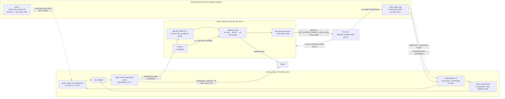
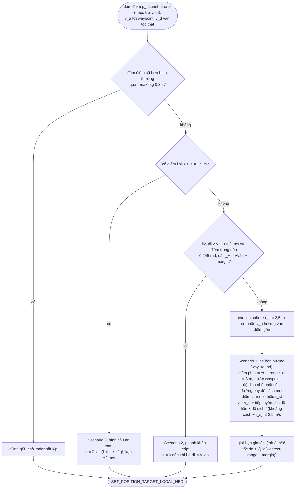
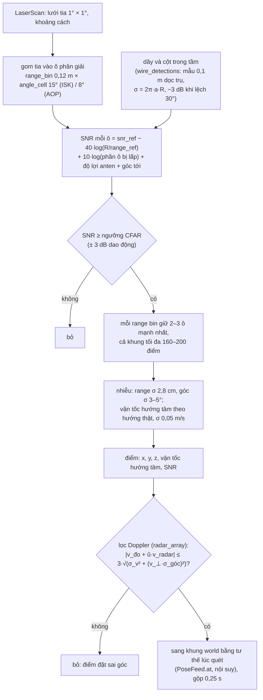
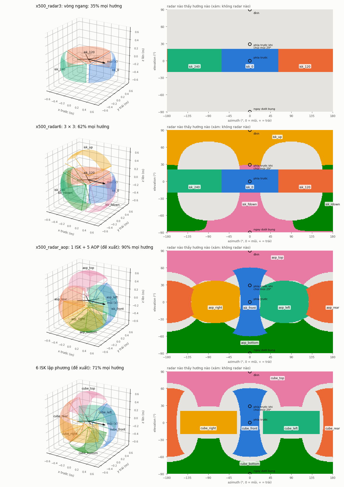
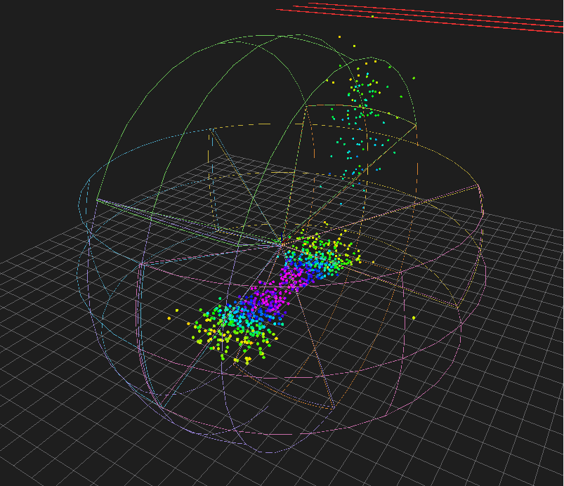

# px4-mapping: tài liệu đầy đủ

*Bản README chi tiết trước khi đóng gói (kiến trúc, mô hình radar, các bố trí, US-D1). Mọi lệnh chạy trong thư mục gốc của repo.*

Tránh vật cản bằng radar mmWave mô phỏng trên PX4 SITL (Gazebo Harmonic), theo bài báo Malle & Ebeid 2026:
sáu radar TI IWR6843 (1 ISK nhìn trước + 5 AOP) cho một đám điểm 3D quanh drone, và một node Python né dây điện,
cột, tường bằng cách sửa vận tốc gửi tới PX4 (Offboard). PX4 chạy nguyên bản; mọi thứ nằm trong thư mục này.

Thêm: lập map bằng radar + RTK, thời gian thực trong 300 kbit/s hoặc sau chuyến bay ([mục riêng](#lập-map-bằng-radar--rtk)).

Ngoài ra: radar đo độ cao Ainstein US-D1 qua driver PX4 và Collision Prevention ([phần cuối](#px4-driver-for-the-us-d1-px4_module)).

Mọi lệnh chạy trong `examples/px4-mapping/`.

## Cần có

PX4 SITL đã build (`make px4_sitl` ở gốc repo), Gazebo Harmonic, ROS 2 Humble (RViz), Python: numpy, matplotlib,
PyYAML, pytest. Một lần, và sau mỗi lần sửa `profiles/*.yaml` hay `scripts/radar_layouts.py`:

```bash
scripts/make_isk_x3.sh          # sinh model radar và các vehicle nhiều radar
```

## Chạy mission né vật cản

Hai terminal. Terminal 1 mở sim, Gazebo và RViz; terminal 2 bay.

```bash
# terminal 1: 1 ISK + 5 AOP, world chuỗi vật cản
RADARS=aop PX4_GZ_WORLD=power_line_course ./run_sitl.sh

# terminal 2: chờ terminal 1 hiện "PX4 SITL ready" (hoặc pxh>) rồi thêm ~15 s
source env.sh
scripts/avoid_node.py --world power_line_course --speed 5 --timeout 150 \
    --waypoints 20,0,10 39,0,10 50,0,10 60,0,10 71,0,10 82,0,10 98,0,10

# sau chuyến bay: khoảng cách tới từng vật cản, độ cao lúc qua, thời gian phanh
python3 scripts/course_report.py out/avoid.csv --world power_line_course
```

`worlds/power_line_course.sdf`: đoạn dây điện (ba dây 20 mm ở 10 m, dây đất ở 12 m, thân cây lệch 2,5 m), rồi tường
thấp (x 45, đỉnh 9 m), ống ngang trên cao (x 55, 11,5 m), cổng hai cột trái/phải (x 64 và 68, lệch 2,2 m), khối hộp bên
phải (x 76) và một dây thấp (x 86, 8,8 m). Waypoint giữa các vật cản giữ drone ở 10 m trước mỗi vật. Kỳ vọng: chui
dưới dây điện và ống ngang, vượt trên tường và dây thấp, bay giữa cổng, vòng trái khối hộp; cách mọi vật khoảng 2 m.

Cuối chuyến node in `result: PASS` (bay hết mission và không lúc nào cách dây hay vật cản dưới 1 m) hoặc `FAIL`,
ghi `out/avoid.csv`, rồi hạ cánh. Bay lại: `scripts/stop_sim.sh` (hoặc Ctrl+C ở terminal 1) và chạy lại cả hai.

**Các bài khác** (terminal 1 `RADARS=aop ./run_sitl.sh`, world mặc định `power_line`):

| Bài | Terminal 2 |
|---|---|
| Dây điện, bay thẳng 5 m/s | `scripts/avoid_node.py --goal 45 0 10 --speed 5` |
| Tốc độ cao | `scripts/avoid_node.py --goal 45 0 10 --speed 10` |
| Close proximity (đích nằm trên dây) | `scripts/avoid_node.py --goal 27 0 10 --speed 1.5 --timeout 40 --proximity-test` |
| Chui dưới dây (mission ở 8 m) | `scripts/avoid_node.py --waypoints 10,0,8 45,0,8 45,10,8` |
| Dây thép 1,2 mm | terminal 1 thêm `PX4_GZ_WORLD=power_line_thin`; `scripts/avoid_node.py --world power_line_thin --goal 45 0 10 --speed 2` |

Tuỳ chọn hay dùng của `avoid_node.py`:
- `--demo`: bay tới hết `--timeout`, không hạ cánh, để xem logic.
- `--way-round paper`: chỉ tiếp tuyến đứng của bài báo, né lên hoặc xuống.
- `--mode brake`: bản đầu, phanh và giữ.
- `--clearance 2`: biên mong muốn khi né (m).
- `--max-lag 0.3`: dừng giữ khi đám điểm cũ hơn bình thường quá giá trị này (s).
- `--help`: toàn bộ tuỳ chọn.

**Xem trên RViz** (lớp "Avoidance logic", `/avoid/markers`, vẽ mỗi chu kỳ điều khiển):

| Hình | Ý nghĩa |
|---|---|
| cầu xanh dương | hình cầu tránh r_a 8 m; điểm phía trước nằm trong nó (tím) quyết định cách né |
| cầu đỏ | hình cầu an toàn r_s 1,5 m; điểm trong nó (đỏ, to) đẩy drone ra xa |
| hình nón | vùng phanh khẩn cấp dọc hướng bay, dài l_H = v²/2a + margin; cam, đỏ khi đang phanh |
| mũi tên | xanh lá: vận tốc mong muốn; trắng: vận tốc thật; vàng: lệnh gửi PX4; tím: thành phần né; đỏ: đẩy ra |
| chữ trên drone | luật đang áp dụng (`free flight`, `TANGENT (over/under/left/right)`, `EMERGENCY BRAKE`, `SAFETY SPHERE`), tốc độ, số điểm radar |

Cùng lúc có đám điểm radar (`/radar/points`, màu theo SNR), vùng nhìn của 6 radar (`/radar/fov`) và dây thật
(đỏ, `/radar/wires`) để so. Đặt Decay Time của lớp điểm radar lên 2–3 s để thấy dây và cột rõ hình hơn.

**Dừng mọi thứ của ví dụ này** (sim, Gazebo, RViz, node radar, `avoid_node.py`, `avoid_trials.sh`):

```bash
scripts/stop_sim.sh
```

Chỉ dừng tiến trình của px4-mapping; sim của ví dụ khác (px4-auto-tuning, ArduPilot) để nguyên.

## Chạy test

**Unit test** (không cần Gazebo, vài giây; phải ra `101 passed`):

```bash
python3 -m pytest tests -q
```

**Đo tỉ lệ thành công** (một terminal, headless, tự khởi động lại sim trước mỗi lượt; tắt sim đang chạy trước):

```bash
COURSE="--timeout 150 --waypoints 20,0,10 39,0,10 50,0,10 60,0,10 71,0,10 82,0,10 98,0,10"
RADARS=aop AVOID_ARGS="$COURSE" scripts/avoid_trials.sh 3 power_line_course 5     # chuỗi vật cản, 3 lượt
RADARS=aop scripts/avoid_trials.sh 2 power_line 10                                # tốc độ cao
RADARS=aop AVOID_ARGS="--goal 27 0 10 --timeout 40 --proximity-test" scripts/avoid_trials.sh 2 power_line 1.5
cat out/trials/summary.txt
```

Tham số: `avoid_trials.sh <số lượt> <world> <tốc độ m/s> [số lượt bắt đầu]`.
- `AVOID_ARGS`: thêm tuỳ chọn cho `avoid_node.py`.
- `RADAR_ARGS`: thêm tuỳ chọn cho `radar_array.py`, ví dụ `--doppler-gate 0`, `--angle-outlier 0.05`.
- `GUI=1`: mở Gazebo và RViz để xem.
- `NICE=0`: chạy sim ở ưu tiên thường (mặc định 5).

Mỗi lượt khoảng 1,5–2 phút; log và CSV ở `out/trials/<world>_<tốc độ>_<số>.{txt,csv}`.

**Đọc kết quả.** Mỗi lượt có hai dòng trong `summary.txt`:

```
power_line_course 5 m/s #932 exit 0: goal reached; closest  1.91 m to pole_right (wire radius subtracted)
    cloud - true -0.04 m median, -0.18 m 5 %, missed 0 %; radar lag 0.28 s 95 %; load 3.8
```

Dòng thứ hai cho biết lượt test có hợp lệ không, tức radar có theo kịp không:
- **Độ khớp đám điểm** (`scripts/cloud_check.py`): điểm radar gần nhất trừ vật cản thật gần nhất. Hợp lệ khi trung
  vị khoảng −0,1 m trở lên và `missed 0 %`.
- **Độ trễ radar**: tuổi của đám điểm theo đồng hồ sim so với đồng hồ PX4. Khi máy rảnh là 0,16–0,30 s.
- **Load** của máy.

Khi máy bận việc khác, pipeline radar (Python, đơn luồng) không theo kịp: đám điểm cũ, dây phía trước chưa kịp xuất
hiện. Khi đó `avoid_node.py` dừng giữ drone (`radar cloud … s old: holding`) và lượt bị ghi `NOT VALID`. Đó không phải
lỗi tránh vật cản; chạy lại khi máy rảnh. Dòng `no flight` là lượt lỗi thiết lập, không tính.

**Đừng chạy hai `avoid_node.py` cùng lúc.** Cả hai cùng lái một drone qua cổng MAVLink 14540; node thứ hai tự từ chối
khởi động. Khi `avoid_trials.sh` đang chạy (kể cả với `GUI=1`), đừng bay tay trên sim của nó.

**Kết quả gần nhất** (2026-11-03, 1 ISK + 5 AOP, né bốn hướng, máy rảnh):

| Bài | Kết quả | Gần nhất |
|---|---|---|
| Chuỗi vật cản, 5 m/s | 6/6 PASS (#931–936) | 1,90–1,98 m; qua giữa cổng, không phanh |
| Chuỗi vật cản, 5% điểm sai góc, lọc Doppler bật / tắt | 2/2 và 2/2 PASS | 1,90–2,05 m |
| Dây điện 10 m/s | PASS (#951) | 2,21 m |
| Close proximity | PASS (#961) | 2,06 m |

Chi tiết từng lượt, các lỗi đã sửa và lượt không hợp lệ: [docs/radar3_avoidance_results.md](radar3_avoidance_results.md).
Đọc CSV, đổi tham số, lỗi thường gặp: [docs/huong_dan_test.md](huong_dan_test.md).

## Lưu ý khi chạy

**Nhường sim khác.** Các simulation khác trên máy (đặc biệt dự án ArduPilot xe khử khuẩn) được ưu tiên:
- `run_sitl.sh` chỉ khởi động khi máy không có `gz sim`, ArduPilot SITL hay `sim_check/rig.sh` nào trong 60 s liền
  (`scripts/sim_guard.sh`). Nó in `no other simulation; starting once it stays so for 60 s`; chờ ngắn hơn bằng `QUIET_TIME=5`.
- Nếu sim khác khởi động trong lúc chạy, SITL này tự dừng trong khoảng 3 s.
- Gazebo ở đây chạy trong partition riêng (`GZ_PARTITION=px4_mapping`) dưới tên tiến trình `px4_mapping_gazebo`
  (`scripts/gz_launch.rb`); chỉ các PID do launcher tạo (ghi trong `run/pids`) bị dừng khi thoát.

**Hiển thị và GPU** (biến môi trường của `run_sitl.sh`):
- `HEADLESS=1`: không GUI, không RViz. `NO_RVIZ=1`: bỏ RViz.
- `GZ_POINTS=1`: vẽ điểm radar vào cả Gazebo (chậm; mặc định chỉ RViz có điểm, Gazebo vẽ khung vùng nhìn).
- Laptop hai GPU: render trên NVIDIA (PRIME offload, `scripts/gpu.sh`); `GPU=igpu` để giữ GPU tích hợp.
- Đóng đột ngột terminal chạy `run_sitl.sh` thì các tiến trình nó khởi động vẫn được dừng.

## Cách hoạt động

### Kiến trúc hệ thống

Mọi thứ nằm ngoài firmware: PX4 SITL chạy nguyên bản (chỉ bám vận tốc Offboard), radar được mô phỏng và thuật toán
tránh vật cản chạy trong hai tiến trình Python. `run_sitl.sh` khởi động Gazebo, PX4 và `radar_array.py`;
`avoid_node.py` chạy ở terminal thứ hai.



Khung toạ độ:

| Khung | Trục | Dùng ở |
|---|---|---|
| radar (`radar_link_<tên>`) | x là trục ngắm | `radar_model.detect`, `wire_detections` |
| `base_link` | FLU (trước, trái, lên), gắn thân | `/radar/points`, vị trí gắn trong `radar_layouts.py` |
| `map` | ENU = trục world Gazebo, gốc tại điểm spawn | `/radar/points_map`, `avoid_node.py`, waypoint |
| PX4 local | NED | chỉ ở chỗ gửi/nhận MAVLink (`send()`, `poll()` đổi trục) |

### Logic tránh vật cản (`tangent_avoid`, mỗi chu kỳ 20 Hz)



Né bốn hướng (`way_round`): thử 16 hướng × 0,1–5 m dịch đường bay trong mặt phẳng vuông góc với hướng bay, chọn độ
dịch có chi phí nhỏ nhất (độ dài + phạt khi cách vật dưới 2 m, phạt nặng dưới r_s; cấm dưới r_s/2). Kết quả: dây ngang
thì vượt trên hoặc chui dưới như bài báo; cột bên cạnh thì vòng ngang; khối thì vòng phía trống; cổng hẹp thì bay
giữa. Vận tốc né tỉ lệ với độ dịch còn thiếu (không phụ thuộc số điểm radar), nên không vọt lố.
`--way-round paper` dùng đúng tiếp tuyến đứng t = (p̂ × ẑ) × p̂ của bài (chỉ lên/xuống).

Phần theo bài báo và mã tác giả, phần thêm của ví dụ này và lý do (lượt thử cụ thể):
[docs/paper_malle2026_notes.md](paper_malle2026_notes.md).

### Mô hình radar (mỗi khung, mỗi radar)

Gazebo không có sensor radar. Radar được mô phỏng ở mức đám điểm đầu ra (như firmware TI xuất), không ở mức tín
hiệu: mỗi radar là một `gpu_lidar` cùng FOV với radar thật (lưới tia 1° × 1°), và `radar_model.py` biến lưới khoảng
cách dày, không nhiễu đó thành đám điểm thưa.



Đọc đám điểm: mỗi chấm là một ô (khoảng cách × hướng) có tín hiệu vượt ngưỡng, không phải một tia chạm vật. Khoảng
cách rất chính xác (±3 cm), hướng kém (±3–5°, tức gần 1 m ở 10 m). Dây dài hiện thành một hàng chấm thưa, chỉ ở đoạn
gần vuông góc với hướng nhìn; tường lớn chỉ còn vài chục chấm.

Tham số lấy từ cấu hình radar tác giả bay (`xwr6843ISK_profile_10Hz_v2.cfg`) và bài báo, phần còn lại là ước lượng có
ghi chú trong `profiles/iwr6843isk.yaml` và `profiles/iwr6843aop.yaml`. ISK thấy dây 20 mm chắc tới khoảng 15 m, AOP
khoảng 8 m (bài báo: "từ khoảng 7 m"), dây thép 1,2 mm vài mét. Dây mảnh hơn khoảng cách giữa các tia nên model
`wire_*` ẩn khỏi tia (`visibility_flags` 2) và chỉ đi qua `wire_detections`; cột và thân cây đi cả hai đường.

**Lọc Doppler.** Radar đo Doppler theo hướng nhìn thật, không phụ thuộc góc nó ước lượng ra. Vì vậy điểm bị đặt sai
góc (búp phụ, nhập nhằng góc) có vận tốc hướng tâm không khớp với một điểm tĩnh tại chỗ nó được đặt, và bị bỏ
(`--doppler-gate 3`, 0 là tắt). Ở 5 m/s bộ lọc giữ ≥ 99,8% điểm tốt và loại ≥ 88% điểm sai góc từ 15° trở lên trong
mặt phẳng chứa hướng bay. Sai góc vuông góc với mặt phẳng đó, hay khi drone treo, thì không thấy được. Thử với điểm
sai góc: `RADAR_ARGS="--angle-outlier 0.05"`.

**Thời điểm.** Mỗi khung được đặt vào world bằng tư thế nội suy đúng lúc quét, và khi gộp mỗi radar giữ vị trí world
của khung riêng nó. So với dùng tư thế mới nhất, đuôi "điểm gần hơn thật" giảm từ khoảng 0,4 m xuống 0,17 m.

### Bố trí radar

`scripts/radar_layouts.py` là bảng duy nhất cho cả SDF của vehicle (sinh bởi `scripts/make_isk_x3.sh`) và
`radar_array.py`, nên đám điểm luôn dùng đúng vị trí gắn của mô phỏng.

| Bố trí | Radar | Phủ mặt cầu | Ghi chú |
|---|---|---|---|
| `x500_radar3` (`RADARS=3`) | `isk_0`, `isk_120`, `isk_240`: vòng ngang dưới thân | 35% | 360° phương ngang, chỉ ±20° phương đứng |
| `x500_radar6` (`RADARS=6`) | vòng ngang + `isk_up` (thẳng lên), `isk_fdown`, `isk_rdown` (trước/sau chếch xuống 30°), quạt đứng | 62% | 3 × 3; ngay dưới bụng chỉ ở mép quạt (−12 dB) |
| 6 ISK lập phương (`CANDIDATES["cube"]`, chưa có model) | một ISK mỗi mặt | 71% | giới hạn của 6 ISK |
| **1 ISK + 5 AOP** (`x500_radar_aop`, `RADARS=aop`) | ISK trước quạt đứng; AOP sau, trái/phải (xoay 15° về trước), trên, dưới | **90,6%** | **dùng mặc định trong README này**; như bài báo |



Mỗi hàng là một bố trí. Bên trái: x500 (mũi theo trục x, mũi tên đen) và vùng nhìn của từng radar (ISK 122° × 41°,
AOP 75° × 104°), vẽ dài 0,6 m từ chỗ gắn. Bên phải: mọi hướng quanh drone trong khung `base_link` (azimuth 0° là mũi,
dương sang trái; elevation dương là lên), tô màu theo radar thấy hướng đó, xám là không radar nào thấy. Bản đồ phẳng
phóng to vùng gần đỉnh và đáy, nên con số % ở tiêu đề mới là độ phủ thật. Các vòng tròn đánh dấu những hướng đã quyết
định kết quả bay: phía trước, phía trước khi chúi mũi 29° (lượt #122), ngay dưới bụng (lượt close proximity), và
đỉnh. Vẽ lại: `python3 scripts/plot_radar_layouts.py` (hoặc `python3 scripts/plot_radar_layouts.py 6 cube out.png`).



RViz khi chạy `RADARS=6 ./run_sitl.sh`, drone lơ lửng ở 2,5 m. Khung dây màu là vùng nhìn của từng radar
(`/radar/fov`, mỗi radar một màu, dài 10 m). Chấm là điểm radar (`/radar/points`, màu theo SNR 10–40 dB): đám phía
dưới là mặt đất do `isk_fdown`/`isk_rdown` thấy, cụm phía trên bên phải là thân cây. Đường đỏ ở góc trên là dây
điện thật (`/radar/wires`, để so), còn quá xa để radar thấy.

**Chọn bố trí.** Bài báo dùng hai loại radar TI: IWR6843**ISK** (anten thường, 122° × 41°, thấy dây 20 mm tới khoảng
15 m) và IWR6843**AOP** (anten trên chip, 75° × 104°, thấy dây từ khoảng 7 m). Góc khối một ISK là 1,49 sr, một AOP
2,06 sr; mặt cầu 12,57 sr. Sáu ISK không chồng nhau phủ tối đa 71,2%, sáu AOP tối đa 98%. Nhưng tầm thấy dây quyết
định tốc độ an toàn theo hướng đó, v ≤ √(2·a·(tầm − margin)) (`--detect-range`, a = 3 m/s², margin 1 m): khoảng
9 m/s nơi ISK nhìn, 6 m/s nơi chỉ AOP nhìn.

So sánh (hướng các radar tối ưu bằng mô phỏng tôi luyện trên 20 000 hướng, bắt buộc thấy trước, sau, hai bên, đỉnh
và đáy; "đều đặn" là bố trí tốt nhất trong lưới các cách lắp dễ làm; dải ±30° là phương ngang, nơi có dây):

| Bố trí (6 radar) | Phủ mặt cầu | Dải ±30° | Phủ với tầm 15 m | Phía trước | Ngay dưới bụng | Ghi chú |
|---|---|---|---|---|---|---|
| 6 ISK `x500_radar6` | 62% | 78% | 62% | 15 m, tới chúi 60° (mép quạt từ 25°) | mép quạt | |
| 6 ISK lập phương | 71% | 73% | 71% | 15 m, tới chúi 60° | 15 m, trục ngắm | giới hạn của 6 ISK |
| 1 ISK + 5 AOP, đúng như launch của tác giả | 83% | 74% | 12% | 15 m, tới chúi 60° | 7 m | đọc khung radar TI như driver |
| **1 ISK + 5 AOP, đều đặn** (`x500_radar_aop`) | **90,6%** | **98%** | 12% | 15 m, tới chúi 60° | 7 m, trục ngắm | **đề xuất** |
| 1 ISK + 5 AOP, tối ưu tự do | 91,0% | 87% | 12% | như trên | 7 m | hướng lệch lạc, không hơn |
| 2 ISK (trước, sau) + 4 AOP, tối ưu | 88% | 84% | 24% | 15 m | 7 m | chỉ đáng nếu hay bay lùi |
| 6 AOP, tối ưu | 96% | 95% | 0% | **7 m** | 7 m | kín nhất nhưng chỉ ~6 m/s mọi hướng |

**Kết luận: 1 ISK + 5 AOP, bố trí `x500_radar_aop` (`RADARS=aop`).**
- ISK đặt trước, xoay quạt 122° đứng dọc: nhìn xa 15 m theo hướng bay và vẫn thấy dây phía trước khi drone chúi mũi
  tới 60° (sửa lượt #122).
- AOP sau: quạt rộng nằm ngang. AOP trái và phải: xoay 15° về phía trước, quạt rộng theo trục trước–sau.
- AOP trên và dưới: quạt rộng theo trục trái–phải, nhìn thẳng lên và thẳng xuống; ngay dưới bụng nằm đúng trục ngắm
  (sửa lượt close proximity).
- AOP sau và hai bên gắn thấp hơn `base_link` 15 cm: gắn cao hơn thì chúng thấy cánh quạt của chính drone.

Bố trí này phủ 90,6% mọi hướng và 98% dải phương ngang. Đổi lại, chỉ phía trước nhìn xa 15 m; các hướng khác 7 m, nên
drone nên quay mũi theo hướng bay, và bay ngang, bay lùi hay leo/hạ ở khoảng 6 m/s. Bài báo báo cáo đúng mức đó: tới
10 m/s phía trước, 5 m/s theo các hướng khác. Đây cũng là cách tác giả định lắp, theo chú thích trong launch file của
họ; nếu đọc theo khung radar TI như driver thì cách họ lắp thật chỉ phủ 83%
([docs/paper_malle2026_notes.md](paper_malle2026_notes.md)).

### Phương án khác cho tránh vật cản

| Phương án | Ý tưởng | Hợp với radar đám điểm này? |
|---|---|---|
| Bản đồ cục bộ có nhớ | giữ điểm trong khung `map` vài giây (voxel 0,25 m, mờ dần theo thời gian) thay vì 0,3 s | **có**: dây đã thấy phía trước vẫn còn khi nằm dưới bụng hay ra khỏi FOV lúc chúi mũi; lọc nhiễu nhấp nháy |
| Khớp dây (RANSAC đường thẳng / dây võng, theo dõi qua các khung) | đổi điểm thành đoạn dây; tiếp tuyến lấy trong mặt phẳng vuông góc với dây (mặt K_p của bài) | **có**: độ dịch tính trên đoạn dây thay vì từng điểm, ít nhạy với điểm nhiễu (lỗi #702); bỏ được hành lang 2 m |
| Bộ lọc an toàn CBF | sửa v_u ít nhất sao cho ḣ ≥ −α·h với h = ‖p‖ − r_s cho mọi điểm (nghiệm đóng hoặc QP) | **có**: thay hình cầu an toàn và caution sphere bằng một luật trơn, có chứng minh; đã có bản tích hợp PX4 dùng số đo khoảng cách (Misyats 2025) |
| PX4 Collision Prevention | radar → `obstacle_distance` 72 ô ngang → PX4 hãm vận tốc | **không cho dây**: chỉ mặt phẳng ngang, chỉ Position mode (không mission); ví dụ này đã dùng nó với US-D1 |
| Chọn hướng kiểu 3DVFH+ | biểu đồ cực các hướng trống, chọn hướng gần đích nhất | được, nhưng đám điểm thưa; PX4-Avoidance đã ngừng, cây PX4 này không còn `COM_OBS_AVOID` |
| Bản đồ + lập đường (nvblox, EGO-Planner) | lập quỹ đạo trên bản đồ 3D | nặng, cần nhiều điểm hơn radar cho |

Thứ tự đề xuất: bản đồ cục bộ có nhớ, rồi khớp dây, rồi CBF thay hình cầu an toàn; luật tiếp tuyến của bài giữ làm
lệnh danh định.

## Các bài và cấu hình khác

### Bố trí 3 radar và 3 × 3

Mọi lệnh ở trên chạy được với bố trí khác, chỉ đổi `RADARS`:
- `RADARS=3`: ba ISK cách nhau 120° dưới thân (`models/x500_radar3`). Phủ kín 360° phương ngang, chồng nhau 2°;
  phương đứng chỉ ±20°.
- `RADARS=6`: vòng ngang trên cộng một vòng đứng 3 radar xoay 90° (`models/x500_radar6`). Phủ 62% mọi hướng; các
  hướng chéo giữa hai vòng không radar nào thấy.

Profile ISK theo cấu hình radar tác giả bay (`xwr6843ISK_profile_10Hz_v2.cfg`): tầm 0,2–30 m, ô góc 15°, ngưỡng 15 dB.
World `power_line` (ba dây 20 mm cách 3 m ở 10 m, dây đất 10 mm ở 12 m, thân cây 30 cm cao 15 m lệch 2,5 m khỏi
đường bay, trụ cách 35 m) và `power_line_thin` (một dây thép 1,2 mm).

### Bài test hover (một radar)

```bash
./run_sitl.sh                               # world radar_hover, models/x500_radar
source env.sh && ./scripts/hover_test.py    # terminal khác: cất cánh, hover, chấm điểm, hạ cánh
```

`hover_test.py` lấy vật cản từ chính file world (các model tĩnh dạng box/cylinder, `scripts/scene.py`), ngưỡng từ
`worlds/<world>.targets.yaml`, và vị trí radar thật từ Gazebo. Mỗi điểm radar được gán: thuộc vật cản (khi điểm đó thực
sự sinh ra từ vật cản: mô phỏng biết vị trí không nhiễu của mỗi detection), mặt đất (gần mặt phẳng RANSAC ước lượng từ
chính các điểm), hoặc không giải thích được. Kết quả: bảng trên terminal, `out/hover_test.png`,
`out/hover_test_frames.csv`.

| Exit code | Ý nghĩa |
|---|---|
| 0 | mọi vật cản đạt ngưỡng |
| 1 | có vật cản không đạt |
| 2 | lỗi thiết lập (chưa chạy SITL, PX4 không nhận lệnh cất cánh, …) |
| 3 | radar ngừng phát (quá `--stall-timeout` s không có scan) |
| 4 | SITL bị dừng, thường là để nhường sim khác |

Bàn thử tĩnh (radar đứng yên, `worlds/radar_test.sdf`): `./scripts/run_radar_test.sh` in bảng và vẽ
`out/radar_test.png`; `--view` để xem trực tiếp.

### Đổi radar (một radar)

Mỗi loại radar là một file trong `profiles/`: lưới tia của sensor Gazebo, tham số mô hình, và (tuỳ chọn) khối lượng,
kích thước khối radar (`body:`) cùng tầm vẽ khung vùng phủ (`display: fov_range`, mặc định 4 m).

| Profile | Radar | Vùng nhìn, tầm | Dùng cho |
|---|---|---|---|
| `iwr6843isk.yaml` | TI IWR6843ISK tầm xa, đám điểm 3D, như radar trước của bài báo | 122° × 41°, 10 Hz, 0,2–30 m | mọi bố trí nhiều radar, `radar_hover` |
| `iwr6843aop.yaml` | TI IWR6843AOP tầm ngắn, như các radar bên của bài báo | 75° × 104° | `x500_radar_aop` |
| `us_d1.yaml` | Ainstein US-D1, một khoảng cách và SNR mỗi gói | 43° × 30°, 0,5–50 m, 100 Hz | `us_d1_wall`, `us_d1_sides` |

```bash
python3 scripts/make_radar_model.py profiles/iwr6843isk.yaml   # hoặc iwr6843aop.yaml, us_d1.yaml
./run_sitl.sh                                                 # world radar_hover
source env.sh && ./scripts/hover_test.py                      # terminal khác
```

Lệnh này sinh lại `models/radar_mmwave/model.sdf`, khung vùng phủ `meshes/fov.stl` và `profile.yaml`; mọi script lấy
tham số mặc định từ `profile.yaml` (ghi đè được bằng cờ, ví dụ `--snr-ref 48`). Vị trí gắn nằm trong
`models/x500_radar/model.sdf` (dưới thân, nhìn về phía trước). Vật cản nằm ngoài vùng nhìn của profile đang dùng được
in là `(out of view)` và không chấm điểm. Ngưỡng của `worlds/radar_hover.targets.yaml` được hiệu chỉnh cho radar trước
đây, chưa cho ISK: cột ở 5,7 m đạt 85% so với ngưỡng 90%.

Chọn cảm biến tránh vật cản (radar hay lidar, tầm 100 m, xử lý trên máy bay, giao diện PX4):
[docs/radar_survey.md](radar_survey.md).

## Lập map bằng radar + RTK

Bay khảo sát bãi `worlds/survey_site`. Né vật cản luôn bật trong suốt chuyến bay. Mỗi vật được xác định với vị trí
tuyệt đối, kích thước và point cloud riêng. Có hai cách lập map:
- **Thời gian thực:** map gửi về mặt đất qua đường truyền ≤ 300 kbit/s, xem trực tiếp trên RViz.
- **Sau chuyến bay:** từ bản ghi radar đầy đủ và log PX4.

Mọi điểm radar được đặt vào hệ thế giới bằng **pose ước lượng của PX4** (EKF2 với RTK), không dùng ground truth.
Phép đặt tính cả roll, pitch và yaw của drone, cùng vị trí và hướng gắn của từng radar, tại đúng thời điểm quét.

**Hệ toạ độ của kết quả: hệ local của PX4 (NED).**
- Gốc là gốc của EKF2, tức chỗ drone cất cánh; x hướng bắc, y hướng đông, z hướng xuống (m).
- Đây là hệ PX4 dùng cho `LOCAL_POSITION_NED`, `vehicle_local_position` và setpoint, nên toạ độ vật đưa thẳng vào
  được mission hay điều khiển.
- Mỗi file kết quả ghi rõ hệ của nó, kèm gốc dưới dạng lat/lon/alt (tuyệt đối, từ RTK).
- `--frame world` cho kết quả ở hệ world ENU của bãi thử (x đông, y bắc, z lên), là hệ dùng để chấm điểm.
- Code chuyển hệ: `scripts/frames.py`.

- Kết quả tổng hợp: [docs/survey_mapping_results.md](survey_mapping_results.md).
- Kế hoạch và chi tiết từng giai đoạn: [docs/survey_mapping_plan.md](survey_mapping_plan.md).

### Lệnh nhanh

Copy từng khối, chạy theo thứ tự. Mỗi terminal mới đều bắt đầu bằng `cd` và `source env.sh` (ROS 2 Humble, và
partition Gazebo riêng của ví dụ này).

**Bước 0. Một lần:** build PX4 SITL, sinh model radar, build module C++.

```bash
cd ~/PX4 && make px4_sitl                    # nếu chưa build
cd ~/PX4/examples/px4-mapping
source env.sh
pip install pybind11 pymavlink pyulog        # nếu chưa có
scripts/make_isk_x3.sh                       # model radar và các vehicle nhiều radar
cpp/build.sh                                 # module C++ của bộ lập map
python3 -m pytest tests -q                   # phải ra "101 passed"
```

**Bước 1. Bay và lập map thời gian thực:** 1 terminal, khoảng 12–15 phút (sim chạy chậm hơn thời gian thực), tự dừng khi bay xong.

```bash
cd ~/PX4/examples/px4-mapping
source env.sh
HEADLESS=1 VIEW=0 scripts/survey_live.sh live_h 300     # 1a. kiểm headless trước: phải ra "result:  PASS"
scripts/survey_live.sh live_1 300                       # 1b. rồi mới chạy có Gazebo GUI + RViz
```

- Ctrl+C dừng mọi thứ script đã khởi động.
- RViz được để mở với map cuối; đóng bằng tay.

**Bước 2. Xử lý sau chuyến bay**, trên chuyến vừa bay (`out/survey/live_1`):

```bash
cd ~/PX4/examples/px4-mapping
scripts/survey_objects.py out/survey/live_1             # vật tìm được: bảng sai số; objects.yaml, .ply từng vật (hệ NED)
xdg-open out/survey/live_1.objects.png                  # hình chiếu bằng và chiếu đứng, so với vật thật
scripts/survey_process.py out/survey/live_1            # mọi điểm radar (.map.ply, hệ NED)
scripts/survey_matrix.py out/survey/live_1              # ảnh hưởng của lệch đồng hồ, lệch lắp radar
scripts/realtime_eval.py out/survey/live_1 --kbps 300 50   # nếu đường truyền chỉ 50 kbit/s thì sao
```

**Xem map dạng point cloud** (thực tế hơn RViz; cần chạy `survey_process.py` và `survey_objects.py` ở trên trước):

```bash
scripts/view_map.py out/survey/live_1                    # cửa sổ 3D (Open3D)
scripts/view_map.py out/survey/live_1 --color height --ground   # tô theo độ cao, có cả mặt đất
scripts/view_map.py out/survey/live_1 --export --up      # live_1.map.color_up.ply có màu, mở bằng CloudCompare / MeshLab
```

- Màu mặc định: cột xanh dương, dây cam, khối xanh lá, mỗi vật hiện point cloud gọn (`.sharp.ply`). Điểm không
  thuộc vật nào (bóng ma, điểm lạc) hiện xám tối theo độ cao.
- `--all`: tô mọi điểm của vật. `--halo`: hiện xám phần quầng mà point cloud gọn bỏ đi.
- `--color snr`: tô theo cường độ tín hiệu. `--color radar`: mỗi radar một màu.
- Cửa sổ có nhãn tên và toạ độ NED từng vật, cùng trục N/E/D tại gốc EKF.
- Chuột: kéo trái để xoay, cuộn để zoom, Shift + kéo trái để dời.
- Đây là điểm radar thật như radar trả về, không phải ô voxel như trên RViz.
- Point cloud gọn: mỗi điểm nặng (5 / max(r, 5))² theo khoảng cách đo r. Chỉ giữ ô 0,5 m có trọng số ≥ 0,35 lần ô nặng
  nhất trong vòng 1,5 m, nên điểm đo từ gần được giữ, quầng do sai số góc khi đo từ xa bị bỏ.
- `--export` không có `--up` ghi theo NED (z xuống), nên mở bằng phần mềm khác sẽ thấy map lộn ngược.
- CloudCompare cài bằng `sudo apt install cloudcompare`; Open3D đã có sẵn.

**Bước 3 (tuỳ chọn). Bay tay bằng hai terminal**, không có map thời gian thực, chỉ ghi dữ liệu:

```bash
# terminal 1
cd ~/PX4/examples/px4-mapping
source env.sh
PX4_GZ_WORLD=survey_site RADARS=aop GPS=rtk RADAR_LOG=1 \
    RADAR_ARGS="--surface-law 20 --surface-db 8" ./run_sitl.sh

# terminal 2: chờ terminal 1 hiện "PX4 SITL ready"
cd ~/PX4/examples/px4-mapping
source env.sh
scripts/survey_mission.py --tag rtk_1                   # bay xong: out/survey/rtk_1.{ulg,radar,...}
scripts/stop_sim.sh                                     # dừng sim
scripts/survey_objects.py out/survey/rtk_1              # rồi xử lý như bước 2
```

**Các biến thể của bước 1:**

| Muốn | Lệnh |
|---|---|
| Chỉ RViz, không Gazebo GUI | `HEADLESS=1 scripts/survey_live.sh live_2 300` |
| GPS thường thay cho RTK | `GPS=std scripts/survey_live.sh std_1 300` |
| Đường truyền chậm hơn | `scripts/survey_live.sh live_50 50` |
| Mô hình bề mặt mặc định (như né vật cản) | `SURFACE= scripts/survey_live.sh live_3 300` |
| Xem lại trên RViz một chuyến đã bay, không bay lại | terminal 1: `source env.sh && rviz2 -d rviz/ground.rviz`<br>terminal 2: `source env.sh && scripts/radar_link.py out/survey/live_1 && scripts/ground_map.py out/survey/live_1 --speed 5 --rviz` (phát lại nhanh gấp 5 lần; ghi đè `live_1.ground.*`) |
| Chỉ in danh sách waypoint | `scripts/survey_mission.py --print` |

### Bãi thử và đường bay

| Vật | Vị trí (x, y) | Kích thước |
|---|---|---|
| 2 cột điện, có xà ngang | (15, 0), (45, 0) | cao 13 m |
| 3 dây pha, dọc trục x | y = −3, 0, 3 | Ø 20 mm, cao 10 m, dài 30 m |
| dây đất | y = 0 | Ø 10 mm, cao 12 m |
| nhà | (25, 7) | 6 × 4 × 4 m |
| tường | (40, 7) | 5 × 0,4 × 6 m |
| cột đèn, thân cây | (35, −10,75), (20, −10,75) | cao 8 m và 10 m |

Đáp án để chấm điểm nằm trong `worlds/survey_site.truth.yaml`; khi sửa SDF thì phải sửa cả file này.

Đường bay (`scripts/survey_mission.py`, 43 waypoint, 691 m, bay khoảng 4 phút theo đồng hồ sim; mọi vật cách đường bay ≥ 3 m):
1. Zigzag dọc trục x ở y = ±14, độ cao 6 m và 12 m. Riêng đoạn phía bắc từ đông về tây bay thấp ở y = 12,5, độ cao
   3 m, ngang tầm nhà và tường. `--low-pass-alt 0` bỏ lượt bay thấp này (đường bay cũ, 41 waypoint).
2. Bay trên đường dây ở độ cao 16,5 m.
3. Bay dọc hai bên đường dây ở y = 8 và y = −7,5, độ cao 10 m.
4. Bay một vòng tròn r = 20 m quanh (30, 0), rồi về nhà.

`scripts/survey_mission.py --print` in danh sách waypoint.

### Chạy thời gian thực: chi tiết

Không có module C++ (`cpp/build.sh`) thì code tự chạy bằng Python, chậm hơn khoảng 55 lần; `ONBOARD_PY=1` ép dùng
Python. Mỗi lần sửa `cpp/mapper_core.cpp` thì build lại.

Cú pháp: `scripts/survey_live.sh [tag] [kbit/s]`, mặc định `live_1 300`; lệnh và biến thể ở [Lệnh nhanh](#lệnh-nhanh).
Script tự `source env.sh`. Nó chạy cả chuỗi: sim, mission, bộ lập map trên drone, đường truyền, ground map
và RViz.

Dữ liệu đi qua 4 bước, như trên drone thật:

```
radar_array.py --frames-udp 14610      khung radar thô (như 6 radar gửi tới máy tính trên drone)
        │
onboard_live.py                        pose PX4 qua MAVLink 14550 (chỉ mẫu đã tới), đặt điểm vào hệ thế giới,
        │                              lọc Doppler, map voxel 0,5 m (xác nhận khi thấy ≥ 3 khung từ ≥ 2 m)
        │  UDP 14600, ≤ kbit/s đặt     ưu tiên: pose 10 Hz → voxel (9 B, không bỏ) → điểm radar (khi còn chỗ)
        ▼
ground_map.py --udp 14600              map dưới mặt đất, tìm vật mỗi 3 s, hiện lên RViz
```

Terminal in tiến độ từng waypoint, rồi tới cuối chuyến:

```
result:  PASS
done: 16047 frames, link per second median 38, 95 % 110, max 150 kbit/s; ... 104196 of 104196 detections sent
  pylon_a      pole_2     0.03 m  height -0.12
  wire_a       wire_1     0.02 m  length_found 0.94
  ...
```

- Dòng `done` là đường truyền dùng mỗi giây (đã tính header UDP/IP) và số điểm radar gửi được.
- Các dòng sau là từng vật thật: vật tìm được khớp với nó và sai số (m).
- RViz được để mở với map cuối; đóng bằng tay.
- Log chi tiết: `run/onboard_live.log`, `run/ground_map.log`.

**Các lớp trên RViz** (`rviz/ground.rviz`):

| Topic | Nội dung | Mặc định |
|---|---|---|
| `/ground/voxels_sharp` | voxel đã xác nhận, chỉ giữ chỗ có điểm đo gần (đỡ "dày" khi quét nhiều lượt) | bật |
| `/ground/voxels` | mọi voxel đã xác nhận | tắt |
| `/ground/ground` | voxel mặt đất | bật |
| `/ground/objects` | cột (trụ), dây (đoạn thẳng), khối tìm được | bật |
| `/ground/truth` | vật thật, để so | bật |
| `/ground/points` | điểm radar nhận được | tắt |
| `/ground/vehicle`, `/ground/path` | drone và đường bay | bật |
| `/ground/frame` | trục NED của PX4 tại gốc EKF: N đỏ, E xanh lá, D xanh dương | bật |
| `/ground/labels` | tên và vị trí từng vật theo NED, ví dụ `pole_1  N 0.0  E 44.8  h 12.1` | bật |

RViz vẫn vẽ ở hệ `map` (ENU, z lên) để nhìn cho thuận. Toạ độ NED đọc ở nhãn của từng vật và trong file
`.ground.objects.yaml`. Drone gửi gốc EKF xuống mặt đất mỗi giây (bản tin ORIGIN 32 B); trước khi nhận được thì chưa
có trục và nhãn.

Mô hình radar cho bay khảo sát:
- Mặt phẳng lớn giảm theo R⁻² và sáng hơn 8 dB, đặt bằng biến `SURFACE` trong `survey_live.sh`.
  - Lý do: với mặc định R⁻⁴, một bức tường đặt chính diện biến mất khỏi radar AOP từ ngoài 8 m.
  - `SURFACE=` (để trống) dùng lại mặc định.
- Né vật cản (`run_sitl.sh` không có tuỳ chọn này) vẫn dùng R⁻⁴ và 0 dB như cũ.

### Bay tay: dữ liệu ghi lại

Lệnh ở [Lệnh nhanh](#lệnh-nhanh), bước 3.
- `RADAR_LOG=1` ghi mọi khung radar (định dạng như radar thật gửi ra) vào `run/radar_log/`.
- Mission tạo hard link về `out/survey/<tag>.radar/`, kèm log PX4 `out/survey/<tag>.ulg`.
- `survey_live.sh` cũng ghi như vậy, nên chuyến bay thời gian thực cũng xử lý lại được sau chuyến bay.

### Xử lý sau chuyến bay

Không cần `source env.sh`.

```bash
scripts/survey_check.py out/survey/rtk_1              # tần số từng radar, data rate, lệch đồng hồ radar–PX4
scripts/pose_check.py out/survey/rtk_1.ulg            # pose EKF so với thật
scripts/survey_process.py out/survey/rtk_1 --table    # điểm trong hệ thế giới; bảng ngân sách sai số
scripts/survey_objects.py out/survey/rtk_1            # tìm vật: vị trí, kích thước, point cloud từng vật
scripts/survey_matrix.py out/survey/rtk_1             # pose thật / ước lượng, lệch đồng hồ 50/100 ms, lệch lắp 2/5°
scripts/realtime_eval.py out/survey/rtk_1 --kbps 300 100 50   # phát lại qua đường truyền ở nhiều tốc độ
```

Đầu ra trong `out/survey/`:

| File | Nội dung |
|---|---|
| `<tag>.map.ply` | mọi điểm radar, hệ NED của PX4 (dòng `comment frame` trong header ghi hệ và gốc) |
| `<tag>.map.png` | ảnh chấm điểm các điểm radar so với vật thật (hệ world) |
| `<tag>.objects.yaml` | từng vật, hệ NED: loại, vị trí, số điểm, độ tản; đầu file ghi `frame`, gốc lat/lon/alt, `ground_d` |
| `<tag>.objects/<vật>.ply` | point cloud của từng vật, mọi điểm, hệ NED |
| `<tag>.objects/<vật>.sharp.ply` | point cloud gọn của từng vật: bỏ quầng điểm đo từ xa (cột, dây); khối giữ nguyên |
| `<tag>.objects.png` | hình chiếu bằng (đông × bắc) và chiếu đứng (đông × lên), trục theo NED từ gốc EKF |
| `<tag>.ground.objects.yaml` | vật tìm được dưới mặt đất khi chạy live, hệ NED |
| `<tag>.ground.png` | ảnh chấm điểm map dưới mặt đất (hệ world) |

Vị trí từng loại vật trong `objects.yaml`, ví dụ ở `live_6`:

```yaml
frame: px4_local_ned
origin_lat: 47.39797099           # gốc EKF (tuyệt đối)
origin_lon: 8.54616407
origin_alt: 0.237
ground_d: 0.237                   # mặt đất nằm 0,24 m dưới gốc
objects:
- {type: pole, p: [0.022, 44.836, 0.237], h: 12.862, ...}           # chân cột (N, E, D) và chiều cao
- {type: wire, p0: [-3.043, 15.753, -9.801], p1: [-2.979, 43.888, -9.789], ...}   # hai đầu dây
- {type: box, c: [7.601, 24.633, -2.895], size: [3.224, 5.585, 2.287], ...}    # tâm, kích thước theo (N, E, D)
```

Vị trí tương đối giữa hai vật bằng hiệu hai toạ độ. Vị trí so với drone ở một thời điểm bằng toạ độ vật trừ đi
`LOCAL_POSITION_NED` của drone lúc đó.

Một số cờ:
- `--pose truth`: dùng pose thật để so sánh.
- `--frame world` (`survey_objects.py`, `survey_process.py`): ghi theo hệ world ENU thay cho NED.
- `survey_process.py --find-clock`: tìm độ lệch đồng hồ radar từ chính dữ liệu.

### Kết quả (sim, 10/11/2026)

| | RTK, có lượt bay thấp (`low_1`) | RTK, đường bay cũ (`live_5`, `live_6`) | GPS thường (`std_5`, đường bay cũ) |
|---|---|---|---|
| Cột (4) | 4/4, lệch ≤ 0,15 m | 4/4, lệch ≤ 0,14 m | 4/4, lệch ≤ 0,16 m |
| Dây (4) | 4/4, lệch ≤ 0,06 m, thấy 76–94 % chiều dài | 4/4, lệch ≤ 0,06 m | 4/4, lệch ≤ 0,65 m |
| Nhà (6 × 4 × 4 m) | tâm lệch 1,0 m; tìm ra 5,9 × 3,5 × 2,9 m | tâm cao hơn 1,1–1,7 m; cao 1,2–2,3 m | tâm lệch 2,1 m |
| Tường (5 × 0,4 × 6 m) | tâm lệch 0,6 m; tìm ra 4,8 × 0,6 × 4,5 m | tâm cao hơn 1,4–1,7 m; cao 2,7–3,0 m | tâm lệch 1,9 m |
| Vật giả | 0 | 0 | 14 |
| Đường truyền dùng (300 kbit/s) | median 40, max 161 kbit/s | median 38, max 150 kbit/s | median 33, max 141 kbit/s |

- **Dữ liệu thô không vừa 300 kbit/s lúc cao điểm:** theo định dạng TI, 6 radar có đỉnh 369 kbit/s. Vì vậy chỉ
  gửi map về mặt đất, còn dữ liệu thô ghi trên drone.
- **Xuống 50 kbit/s** vẫn đủ cột và dây, chỉ bớt điểm radar (55 % điểm).
- **Với RTK,** lệch đồng hồ ≤ 50 ms và lệch lắp ≤ 2° gần như không đổi kết quả.

Hạn chế:
- Nhà và tường: lượt bay thấp chỉ đi phía bắc, nên mặt phía nam và phần sát đất vẫn thiếu; tìm ra vẫn thấp hơn thật
  1–1,5 m.
- Xà ngang 15 cm không tách được khỏi cột.
- Số liệu lấy từ mô hình radar, chưa đối chiếu với radar thật; GĐ4 (multilateration) chờ dữ liệu thật.

### Lưu ý

- **Nhường sim khác:** `survey_live.sh` dùng `run_sitl.sh`, nên vẫn nhường các sim khác như mọi bài khác.
  - Nó chỉ dừng các tiến trình do chính nó khởi động, theo PID.
  - `QUIET_TIME=5` có sẵn trong script.
- **GUI chậm:** radar trễ sẽ làm `avoid_node` giữ drone (`radar cloud … s old: holding`). `radar_array` cần
  protobuf bản C++.
  - `run_sitl.sh` tự dùng protobuf C++ của hệ thống khi có; `RADAR_FAST_PB=0` tắt.
  - Kiểm tra: CPU của `radar_array` phải dưới khoảng 50 % (`top`); nếu 100 % là đang dùng protobuf Python.
- **So sánh chuyến bay:** chỉ so các chuyến bay trên cùng một bản world. Các chuyến trước ngày 10/11 bay trên bãi
  cũ (cột đèn ở chỗ khác), nên chấm theo `survey_site.truth.yaml` hiện tại sẽ ra sai.

## Thư mục

| | |
|---|---|
| `scripts/avoid_node.py` | node tránh vật cản (`--mode tangent`: luật bài báo + né bốn hướng; `--mode brake`), mission waypoints, kiểm tra độ trễ radar |
| `scripts/avoid_trials.sh`, `stop_sim.sh` | đo tỉ lệ thành công (kèm kiểm tra hợp lệ), dừng mọi tiến trình của ví dụ này |
| `scripts/course_report.py`, `cloud_check.py` | khoảng cách tới từng vật cản sau chuyến bay; độ khớp đám điểm với vật cản thật và độ trễ radar |
| `scripts/radar_model.py` | mô hình radar (thuần numpy) |
| `scripts/radar_stream.py` | khung radar trực tiếp từ Gazebo kèm tư thế lúc quét, vận tốc |
| `scripts/radar_array.py` | nhiều radar thành một đám điểm (ROS 2), kèm dây và cột, lọc Doppler |
| `scripts/radar_layouts.py`, `plot_radar_layouts.py` | vị trí gắn radar của mọi bố trí, độ phủ, sinh SDF; vẽ `docs/img/radar_layouts.png` |
| `scripts/radar_viz.py` | điểm radar lên Gazebo (marker) và ROS 2 (bài một radar) |
| `scripts/scene.py` | vật cản từ world SDF, mặt đất, gán nhãn điểm |
| `scripts/hover_test.py`, `radar_probe.py` | bài test hover, bàn thử tĩnh |
| `scripts/make_radar_model.py`, `make_fov_mesh.py`, `make_isk_x3.sh` | sinh model radar, khung vùng phủ, các vehicle nhiều radar |
| `scripts/survey_mission.py`, `survey_live.sh` | mission khảo sát (qua `avoid_node`); chạy map thời gian thực cả chuỗi |
| `scripts/radar_log.py`, `survey_check.py`, `pose_check.py` | ghi khung radar như phần cứng thật; tốc độ dữ liệu, đồng hồ; pose EKF so với thật |
| `scripts/survey_process.py`, `survey_objects.py`, `survey_matrix.py` | điểm về hệ thế giới (tính độ nghiêng, vị trí gắn); tìm vật; ma trận thử |
| `scripts/frames.py` | chuyển kết quả sang hệ local NED của PX4 (gốc EKF) |
| `scripts/view_map.py` | xem map dạng point cloud (Open3D), xuất `.ply` có màu |
| `scripts/onboard_mapper.py`, `onboard_live.py`, `radar_link.py`, `ground_map.py`, `realtime_eval.py` | map trên drone, đường truyền ≤ 300 kbit/s, ground map và RViz, đánh giá phát lại |
| `cpp/mapper_core.cpp`, `cpp/build.sh` | lõi C++ của bộ lập map trên drone (pybind11) |
| `run_sitl.sh`, `scripts/run_radar_test.sh`, `scripts/sim_guard.sh`, `scripts/gpu.sh` | launcher, nhường sim, chọn GPU |
| `models/`, `worlds/`, `profiles/`, `rviz/`, `gui/` | model, world, profile radar, cấu hình RViz và Gazebo GUI |
| `tests/` | unit test (`python3 -m pytest tests -q`) |
| `docs/` | kết quả, ghi chú bài báo, khảo sát cảm biến, hướng dẫn test |
| `out/`, `run/` | kết quả và log (không vào git) |

## Chưa mô hình hoá

- Bóng ma đa đường (dội mặt đất, giữa các dây); `--angle-outlier` chỉ mô phỏng phần sai góc.
- Độ phản xạ theo vật liệu; vật thể chuyển động, mưa, bụi (Doppler chỉ từ chuyển động của chính radar).
- Nhập nhằng vận tốc Doppler: radar thật chỉ đo được vận tốc trong một dải theo cfg; ở tốc độ cao Doppler có thể bị
  quấn và lọc Doppler sẽ loại nhầm điểm. Cần kiểm tra cfg trước khi bay thật.
- Can nhiễu giữa sáu radar cùng băng 60 GHz trên một khung.
- RCS thật của cột mảnh (radar dùng diện tích tia chiếu tới; riêng dây `wire_*` có mô hình trụ mảnh).
- Đám điểm của IWR6843 không đi qua PX4 (node gửi vận tốc Offboard); US-D1 thì có (driver `us_d1_radar`).

Các tham số ước lượng (nhiễu góc, số điểm mỗi khung, SNR) chưa đối chiếu với dữ liệu radar thật.

## PX4 driver for the US-D1 (px4_module/)

The Ainstein US-D1 goes through a PX4 driver of this example, `us_d1_radar` (up to three sensors; SNR of
13 dB or less reported as "no obstacle"; 43 x 30 deg field of view). It is built as a PX4 external module
into `build/px4_sitl_mapping/` with `scripts/build_px4.sh`: nothing is added to PX4's `src/` or `boards/`, and
the `build/px4_sitl_default/` that the other examples run is never touched. Start it with
`US_D1=1 ./run_sitl.sh` (after `python3 scripts/make_radar_model.py profiles/us_d1.yaml`); see
`px4_module/README.md`.

Three US-D1 (left, ahead, right, about 130 deg) and PX4 collision prevention:

    scripts/make_us_d1_x3.sh             # three radar models at 25 Hz (one Python process cannot do 3 x 100 Hz)
    CP_DIST=5 US_D1=3 PX4_SIM_MODEL=gz_x500_us_d1_up15 PX4_GZ_WORLD=us_d1_wall ./run_sitl.sh
    scripts/cp_test.py --stick 1000      # Position mode at the wall 40 m ahead; where does PX4 stop?

`x500_us_d1_up15` tilts the radars 15 deg up; `x500_us_d1` keeps them level.

Xem trực quan ba radar (`US_D1=3`, không `HEADLESS`): Gazebo có khung FOV mỗi radar, RViz (`rviz/us_d1.rviz`) có khung FOV,
số đo PX4 nhận được từ từng radar và bản đồ 72 ô của collision prevention (`scripts/us_d1_viz.py`, đọc MAVLink 14540).
World `us_d1_sides` có cột, tường, hộp hai bên và cột trong khe giữa các búp. Kết quả: [docs/us_d1_sim_results.md](us_d1_sim_results.md).

